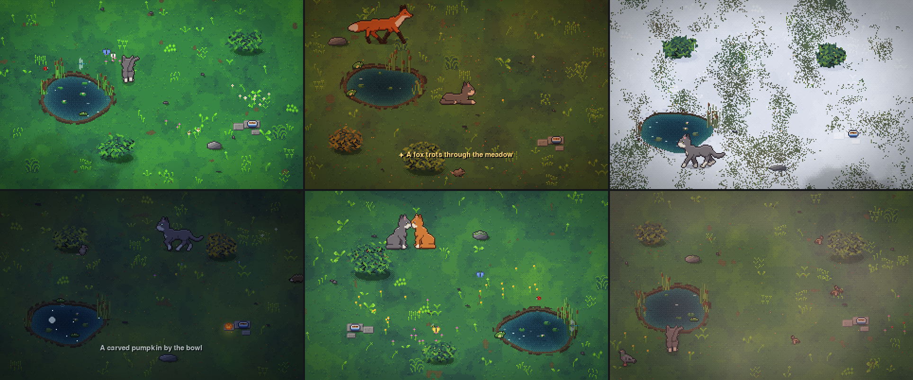

# Meadow (ADHD_trap)

A living pixel-art habitat to watch, or to run as a screensaver. A cat called
Mochi lives in a procedurally grown meadow with a pond, bushes, rocks and
flowers. She follows her own needs: she naps, grooms, eats from her bowl,
drinks at the pond, sunbathes, stalks mice and sparrows, bats at
butterflies, watches the frog, does the occasional zoomies and hides under a
bush when it rains. Around her, the day passes and the weather changes, and
the wildlife comes and goes with them.



## Setup

```bash
python3.12 -m venv venv          # 3.12 or 3.13: pygame 2.6.1 has no wheels for 3.14
source venv/bin/activate
pip install -r requirements.txt
```

## Run

```bash
python main.py                   # a window; time of day follows your clock
python main.py --screensaver     # fullscreen; any key or mouse movement exits
python main.py --time 21:30      # start at dusk
python main.py --speed 60        # one hour per minute
python main.py --date 2026-12-24 # pretend it's Christmas Eve (season, moon)
python main.py --place 51.5,-0.1 # work out the sun and moon for London
python main.py --event "a rainbow"   # make an event happen now (see --help for names)
python main.py --name Pamuk      # call the cat something else (remembered)
python main.py --help            # every option
```

### Keys

| Key | |
|---|---|
| `I` | info panel: the time, weather, temperature, season, sunrise and sunset, the moon, what Mochi is doing, who's around |
| `J` | journal: every event seen so far, and the ones still to find (`???`) |
| `D` | event odds: each tier's timer and chances, what could happen right now (for tuning) |
| `F` / `F11` | fullscreen |
| `T` | time-lapse: 1× → 60× → 600× → back to live time |
| `W` | next weather |
| `N` | grow a new meadow |
| `S` | screenshot (saved to `screenshots/`) |
| `H` | show the key guide again |
| `Esc` / `Q` | quit |

### As a screensaver

`--screensaver` starts fullscreen with the cursor hidden. After a short grace
period, any key, click or deliberate mouse movement quits. macOS can't load a
Python program as a system screensaver directly, so start it yourself or from
an automation such as a Shortcuts action or a hot-corner tool.

As a screensaver it is built to sip power:

- **Lite drawing:** the scene is drawn small (twice the art size) and the
  graphics card scales it up, nearest-neighbour, so pixels stay crisp.
  `--lite` turns this on in a window too; `--full-render` turns it off.
- **Frame rate:** 30 fps, dropping to 15 when nothing on screen moves fast
  (Mochi asleep, nothing flying). Pass `--fps` to fix a rate.

Measured on a MacBook Pro at full-screen size, as a share of one CPU core:

| | CPU |
|---|---|
| full drawing at 60 fps (the window default) | ~32% |
| screensaver, daytime | ~9% |
| screensaver, night | ~11% |

Roughly 5–6% of that is pygame's own cost of putting a frame on screen; a
native screensaver would do much better.

## What lives here

- **The real sky.** Sunrise, sunset and the light in between come from
  where the sun really is, worked out offline for your location. The
  location is guessed from the Mac's time zone (a screensaver can't use
  Location Services); `--place` sets it exactly. Days are long in June and
  short in December, dusk falls when it really does, and the moon has its
  real phase: a full moon lights the meadow silver and shows in the pond
  as a disc, a quarter moon as a half.
- **Seasons** follow the date (flipped in the southern hemisphere):
  - **Spring:** fresh green grass, flowers opening one by one.
  - **Summer:** a dry tint by August, fireflies on warm nights.
  - **Autumn:** the grass turns gold, the shrubs rust and amber, and leaves
    let go of the bushes and gather under them.
  - **Winter:** dun grass, frost on cold clear mornings, and snow when it is
    cold enough. Snow dusts the grass, then settles over it and on top of
    bushes and rocks, and melts in the sun.
  - **Wildlife keeps the calendar:** no butterflies or bees in the cold,
    frogs and hedgehogs hibernate, and weather leans dry in summer and wet
    and windy in autumn.
- **The old tree:** an evergreen whose crown is a roof. Rain and snow
  don't reach the ground beneath it (in winter there's a dry ring in the
  snow, and snow lies on the crown instead). When Mochi is under it the
  crown turns see-through, so she stays in sight.
- **Rain:** Mochi usually runs for the tree (or a bush). Now and then,
  more often if she's curious or bold, she goes out for a look round in
  the wet, or for a drink from a puddle, then hurries back under cover to
  groom the rain off.
- **Day and night:** dawn and dusk light, a golden hour, and a night where
  the cat's eyes catch the light and stars shimmer in the pond. At night,
  Mochi is already asleep under a bush when the meadow starts.
- **Weather** drifts between clear, cloudy, windy, drizzle and rain. Cloud
  shadows cross the grass, grass and reeds sway in gusts, leaves and petals
  blow past, and rain ripples the pond.
- **Wildlife:**
  - **Pond:** a frog sits on the bank, croaks at dusk and in the rain, and
    plops into the water when Mochi comes near. Dragonflies dart over the
    water and fish glide beneath it, now and then leaping.
  - **Meadow:** butterflies settle on flowers and bees visit them on sunny
    days. Ladybirds crawl, and snails come out after rain, leaving
    glistening trails.
  - **Birds:** pigeons and sparrow flocks fly in. They glide down, flare to
    land, walk (pigeons head-bob, sparrows hop), peck and preen, then burst
    into the air when startled. Bird shadows sweep overhead.
  - **Night:** mice come out mostly from dusk through the night, fireflies
    glow, and a hedgehog may snuffle past, rolling into a ball if Mochi
    gets too close.
- **The cat** steers along smooth, curving routes, slows into bends and
  pivots on the spot to turn around. Her gaits are locked to the distance
  she covers, so planted paws never slide. Posture changes have real
  in-between frames (sitting down, lying down, curling up, getting up). She
  blinks, glances about, breathes while she sleeps and stretches when she
  wakes. Her pounces are real hops with a shadow underneath.

## Mochi

Every Mochi is a little different, and stays herself. The first time the
meadow runs she gets a character, kept in the journal from then on:

- **Five traits** (playful, lazy, curious, bold, affectionate) tilt
  everything she does. A lazy cat tires sooner and sleeps longer, a
  curious one explores and watches the pond, a bold one hisses crows away,
  a timid one hides under a bush when the fox comes, an affectionate one
  meows and slow-blinks more and comes to the screen more often.
- **Two quirks**, out of eight:
  - kneader, pond gazer, sunbather, bowl watcher (waits by the bowl before
    meals)
  - chatterer (that jaw-chatter at birds), night owl, early riser, loafer
- **A mood** that the day pushes up and down: good meals, play, a friendly
  visit or the golden butterfly cheer her up; rain, the fox, a fight or
  fireworks make her grumpy. A happy cat kneads and slow-blinks; a grumpy
  one grooms more and plays less.
- **A favourite nap spot**, which she settles on after a few naps there.
- **A friendship with the ginger cat** that grows with every good visit
  (and sours after a fight). Old friends nap side by side.
- **A birthday:** once a year, on the day you first met, she wears a bow.

She is introduced on the first run. The info panel (`I`) and the journal
(`J`) describe her. The meadow itself also stays the same from run to run
(it's hers); `N` grows a new one.

## Encounters

Now and then something happens. Events come in four tiers of rarity, and
each needs the right conditions (time of day, weather, season, the real
date, the moon):

| Tier | How often, roughly | Examples |
|---|---|---|
| Common | several an hour | Mochi chases her tail; pounces on a bird's shadow; chases a skittering leaf; stalks a grasshopper; bats at moths on summer nights; a mouse peeks out of a bush; a feather floats down and she sniffs it; a crow lands and she stares it out; two butterflies dance; dandelion seeds drift past; puddles after a downpour (sparrows bathe, Mochi drinks from them); a dewy spider web glints at dawn |
| Uncommon | a few a day | Mochi brings you a gift (a leaf, a feather, a toy mouse) and leaves it by the bowl; morning mist at dawn; a rainbow mirrored in the pond after a shower; a gust that spins up a whirlwind of leaves; bats at dusk on summer evenings |
| Rare | about one a day | a heron fishing at the pond (it stands, leans out, strikes, sometimes swallows a fish); in early summer, a duck leading her ducklings in a line to the pond for a swim; a fox trotting through at dawn or dusk, pausing to sniff the air; a shooting star across the pond; the ginger cat from next door visits (they touch noses, then sit together, play chase, or fall out); Mochi walks up to the screen, looks at you and taps the glass |
| Legendary | about one a week | the golden butterfly, which Mochi follows all over the meadow; a roe deer stepping out of the dawn mist to graze by the pond (she bounds away if Mochi comes close) |

Others happen when the world makes them true:

- **Full moon:** a clear full-moon night.
- **Meteor showers:** on their real peak nights (the Perseids in August,
  the Geminids in December, and five more).
- **First snow:** the first snow of winter.
- **Calendar:** a carved pumpkin by the bowl in late October, and distant
  New Year fireworks at midnight on 1 January. The fireworks are mirrored
  in the pond, and Mochi hides under a bush until they stop.

How the odds work:

- Only one rare-or-better event happens at a time.
- The longer a tier goes without an event, the likelier one becomes, so a
  long watch is always rewarded.
- Before a legendary event the birds fall quiet and leave.

Uncommon and rarer events show a short caption that fades in and out:
gold with a star for rare, violet with two for legendary.

When the screensaver starts, a caption recaps the last session (which
happened while you were away), for example "While you were away, Mochi saw
a fox at 06:12".

The meadow remembers. The journal lives in
`~/Library/Application Support/Meadow/journal.json` (or wherever
`MEADOW_JOURNAL` points). It holds Mochi's character, the meadow's layout
and every event seen, so the ginger cat's second visit is a return, and a
full moon is only announced once a night however often the screensaver
starts. Press `J` to read it, or pass `--no-journal` to keep nothing (a
new cat and meadow every run).

## How it fits together

```
main.py              entry point
habitat/
  app.py             window, keys, screensaver mode, main loop
  world.py           the meadow's state; the Director keeps wildlife populated
  terrain.py         procedural ground, pond, bushes, rocks, flowers, bowl,
                     walkability grid and interaction spots
  environment.py     clock, weather, temperature, snow and frost, wind,
                     cloud shadows, light colour
  sky.py             sun and moon positions, moon phase, sunrise and
                     sunset, seasons, location from the time zone
  seasons.py         the meadow's look through the year (grading, snow)
  events.py          encounters: rarity tiers, conditions, effects
  journal.py         what has been seen, kept between runs
  personality.py     Mochi's traits, quirks, mood and friendships
  render.py          one integer pixel zoom for all art, depth sorting,
                     a single multiply pass for lighting
  anim.py            sprite playback driven by time or by distance
  paths.py           any-angle route planning (A* + line of sight)
  assets.py          sprite loading, and the cache for drawn sprites
  pixelrig.py        toolkit for posable pixel-art puppets
  cat_art.py         Mochi's puppet: side, front and back views
  cat_anims.py       every cat animation, as poses
  bird_art.py        bird puppet: pigeon, sparrow, crow
  fox_art.py         the fox's puppet (it borrows the cat's gaits)
  deer_art.py        the roe deer's puppet (the same gaits, on long legs)
  pond_art.py        the heron's and the ducks' puppets
  art.py             procedural props (rocks, flowers, reeds, bowl)
  critter_art.py     the smaller creatures' sprites
  particles.py       rain, splashes, dust, leaves, petals, pollen, feathers
  water.py           glints, ripples, fish, night reflections
  hud.py             info panel and key guide
  entities/cat.py    the cat: body, needs, activities
  entities/wildlife.py   birds (pigeons, sparrows, crows), butterflies,
                         mice, fireflies, ladybirds, dragonflies, frogs,
                         hedgehogs, snails, bees, bats, the golden
                         butterfly, the fox, the deer, the heron, the duck
                         and her ducklings, moths, grasshoppers, the
                         Halloween pumpkin
  entities/visitor.py    the ginger cat from next door
tests/               python -m unittest discover -s tests -t .
legacy/              the original single-file version, kept for reference
```

Tunables live in `habitat/config.py`.

## The art

Mochi, the pigeons and the sparrows are drawn by code, from posable
puppets, rather than cut from sprite sheets. Each puppet is a handful of
shapes (body, head, legs, tail, wings) on a fine grid. Every pixel takes the
colour that covers most of it, and then gets an outline and shading. Because
a pose is just numbers, every in-between frame can be drawn: sitting down,
a stretch, a wing beat. Gaits are generated from paw timing, so a planted
paw stays exactly where it is while the body moves over it.

The drawn frames are saved under `assets/generated/` the first time the
game runs, and redrawn automatically whenever the drawing code changes.
Browse the folders to see every frame. To restyle Mochi, edit the palette or
the poses in `habitat/cat_art.py` and `habitat/cat_anims.py`; the cache
redraws on the next start.

The original sprite sheets (`assets/cat`, `assets/pigeon` and others) are
no longer used by the game and are not part of this repository. The loader
and the slicing tool still work with sheets laid out that way, as described
below.

## Sprite sheets (original art)

Animations live under `assets/cat`, one folder per animation, for example
`walk(right)/`, `tail_wag(sit_front)/` or `sleep2(left_front)/`. Frames play
in numeric filename order. Flat numbered files such as `walk_right_01.png`,
`walk_right_02.png` are read too, which is what the slicing tool produces.
Every cat frame is drawn on a 64×64 canvas with the feet at (32, 48), and
detached specks left over from slicing are removed automatically on load.

### Slice a labeled sheet

```bash
python tools/slice_labeled_sheet.py path/to/sheet.png assets/cat \
  64 64 140 --top_margin 20 --left_margin 0 --row_gap 16 --col_gap 8 \
  --labels path/to/row_labels.txt
```

Row labels file (rows start at 0):

```
0=walk_down
1=walk_up
2=walk_right
3=walk_left
```
